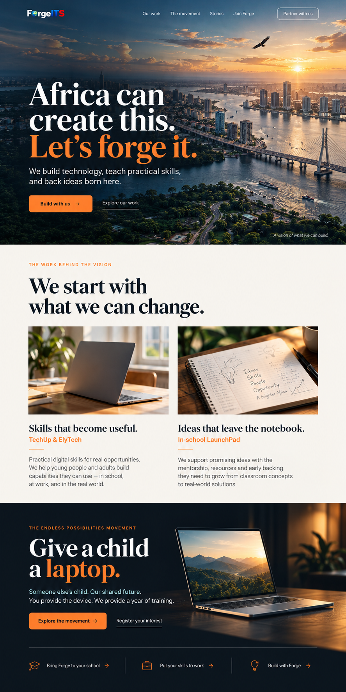
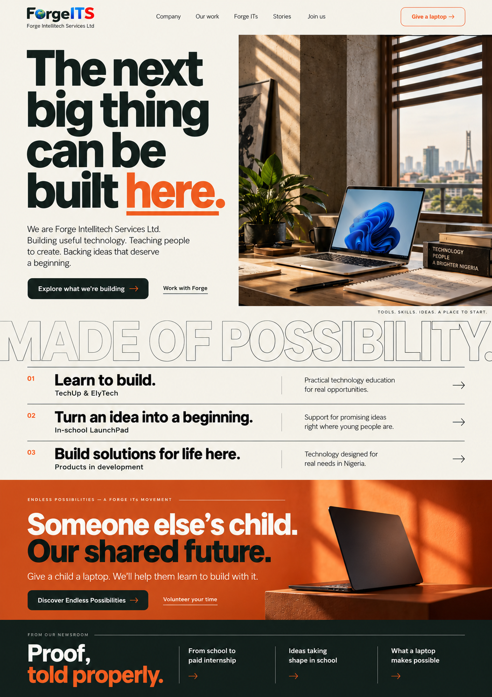
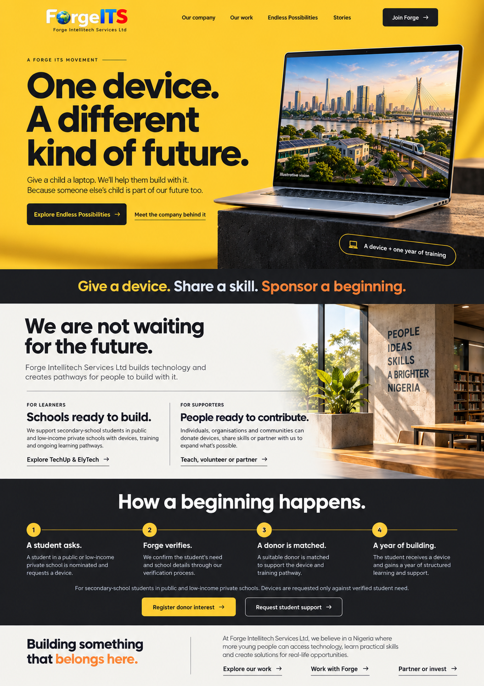

# Forge website redesign: direction review

20 October 2026 · Draft for founder review

Work branch: `codex/forge-website-redesign`.

**Current review:** the founder selected a combination of the first direction's cinematic opening and the second direction's typography and editorial layout. See the [refined desktop and mobile homepage](refined/README.md), now using the new Forge-only wordmark retrieved from Drive. The original studies below remain exploration history, not the current visual target.

**Release rule:** no deployment or promotion to production, merge into the production branch, or live-domain reassignment until the full website is complete and the founder gives explicit final approval. A choice of homepage direction approves design development only.

## The brief

Forge Intellitech Services Ltd is the company. Forge ITs is the movement inside the company. The website should make people want to build with Forge: as employees, educators, schools, volunteers, sponsors, partners or investors.

The new site needs a fresh voice and visual identity built around useful technology, practical learning and ideas becoming real. It should show an ambitious future, then explain the work and the visitor's next step. Education is an important arm of the company, not its whole identity.

The Endless Possibilities page will explain a shared responsibility: someone else's child is part of our future too. Give a Child a Laptop is an ongoing device-and-training campaign, visible across every public page. Requests for actual devices must correspond to vetted student demand. A standing invitation to register donor interest is distinct from a request to supply a device now.

## Homepage visual studies

These are image-generated concept studies, not working pages or final approved copy. Imagined architecture and workspace imagery are illustrative. No children appear. Existing logo references were supplied to generation; final implementation must use the actual source asset rather than regenerated logo pixels.

The three images are presented in this order:

1. **The Future We Forge** — a cinematic future-facing opening, followed by concrete programme stories and an integrated laptop campaign. Strongest expression of the founder's eagle-flight vision. Requires careful media optimisation and a still-image alternative to video.
2. **Built Here** — an editorial company homepage with bold typography, objects and workspaces, clear programme rows and a strong movement section. Makes the company's broader scope easy to understand and lends itself to a fast, restrained implementation.
3. **One Device. Endless Possibilities.** — a movement-first opening using warm yellow, a single device and a visible matching process. Most direct entry to the campaign; needs especially clear corporate content so visitors also understand the company behind it.

**Recommendation:** develop the first direction, with clear company attribution and grounded case stories immediately below the cinematic opening. The second offers a strong alternative if the founder favours a more editorial company presentation. A combined design should be visualised again before implementation.

### Corrections to carry into the chosen design

- Company and movement names need consistent attribution, including in the first study's header/footer.
- The third study compresses programme eligibility: ElyTech serves primary schools too. Secondary-school-only eligibility applies to laptop recipients, not every Forge programme.
- Image text is draft copy; confirm all service promises and replace any invented decorative notebook or book text in production assets.
- The laptop campaign's invitation and narrative run throughout the site, while placement effectiveness is measured after implementation. No position can yet be called the highest converting.
- No case-study imagery generated for the concepts is evidence of a real classroom, workplace, recipient or delivered outcome.

## Proposed page structure

| Page | Purpose | Primary next step |
| --- | --- | --- |
| Home | Establish company ambition, explain its work, show proof and invite participation | Build with us |
| Company / About | Company story, founder motivation, company versus movement, commercial direction | Partner or invest |
| Our work / Products | Explain current programmes and clearly distinguish products in development | Explore the relevant programme or register interest |
| TechUp and ElyTech | Explain the secondary and primary school offers and what practical learning looks like | Bring Forge to my school |
| LaunchPad | Verified previous work, current in-school enterprise development and future ambitions | Partner with LaunchPad |
| Endless Possibilities | Movement story, device support, training, eligibility, matching and participation routes | Register donor interest or request student support |
| Join Forge | Recruitment and contribution routes with different commitments | Apply, volunteer or offer a skill |
| Stories / Blog | Evidence-led case studies, five researched articles and a future video structure | Read, participate or enquire |
| Contact / Partnerships | Route institutional, corporate, government, international and investment enquiries | Start a relevant conversation |
| Privacy and terms | Explain data use and applicable participation terms | Understand the process |

Keep useful existing routes and plan redirects for renamed pages. Do not expose an empty video gallery, empty vacancies, or unavailable application calls to action as if they are active.

## Proposed homepage sequence

1. **A vision worth joining:** a striking hero with one main invitation and one supporting route. Explicitly label imagined future imagery.
2. **The company behind it:** a short explanation of what Forge builds and how education fits the wider mission.
3. **The work in motion:** TechUp/ElyTech and In-school LaunchPad, with real statuses and links to details.
4. **A human account of progress:** an approved case story rather than an unverified counter. Possible stories are the laptop recipients, paid internship with education support, and student ideas entering market research.
5. **Endless Possibilities:** a persistent, distinctive campaign invitation explaining device plus training; link to the full movement page.
6. **Choose your contribution:** routes for schools, talent, volunteers, sponsors, institutions and investors, grouped without forcing them into one generic form.
7. **Stories and a considered footer:** a small selection of meaningful articles and real contact routes.

Campaign entry points: navigation route on every public page; contextually relevant section after a useful story or explanation; a restrained page-end invitation. On mobile, test a dismissible or non-obstructive action that never covers form controls. Record placement, clicks and successful enquiries, with applicable consent. Compare completed journeys, not clicks alone.

## Campaign and application journeys

### Donor

Register interest → describe device and preferences → Forge reviews and matches against vetted need → confirm recipient and delivery arrangements → handover → optional progress updates through Forge.

Accept new or used Windows laptops with Intel Core i5, fifth generation or newer, at least 4 GB RAM and 128 GB SSD. Capture quantity, device details, donor contact/location, preferred recipient location, school category, support for an approved project or for learning, optional call, delivery/pickup preference, additional financial-assistance interest and update preference. Match preferences are requests, not guarantees of an immediate match.

The delivery choices are Forge pickup, delivery to Forge, or delivery to the recipient's school on an agreed day. Coordinate optional calls and delivery through Forge with parent/school involvement. Never publish children's private contact details or home addresses.

### Student

Request support → parent/guardian involvement → school and need verification → qualification decision → await a suitable match → agree to a full year of training → handover and learning follow-up.

Only secondary-school students in public or low-income private schools qualify. Students may be identified through upcoming workshops or apply on the website. A completed application does not guarantee a laptop. Keep application details and case status private. The founder has deferred contract drafting; device ownership and loss/damage/resale terms need a later agreement before handovers, not ad hoc legal wording in homepage copy.

### School

Identify primary, secondary or both → collect location and contact → explain the relevant ElyTech/TechUp offer → save enquiry → notify Forge → review from the dashboard → founder progresses onboarding.

### Applicant / contributor

Select employment, instruction, volunteering, patronage or partnership → ask only relevant questions → save submission → show confirmation → internal review → founder chooses interview invitation or next contact → scheduling → future trainee handoff where relevant.

Do not send interview invitations automatically on application. Preserve the separate dashboard project; this redesign defines integration boundaries, not a dashboard rewrite.

## Delivery sequence and review points

### 1. Direction and content foundations — current stage

- Review relevant archive conversations and provided files, record conflicts, confirm the brief and show three independent homepage studies.
- Founder chooses or refines a direction. Then write the selected design specification, including responsive layout and motion behaviour.
- Review and approve that specification before detailed implementation planning.

### 2. Design system and rewritten content

- Establish typography, palette, spacing, navigation, mobile layouts and reusable campaign treatment from the chosen direction.
- Rewrite every page around the current company/movement structure. Develop case stories from evidence, not AI-generated quotations.
- Prepare detailed video storyboards for founder generation, including text overlays, timing, prompts, transitions and reduced-motion/static alternatives.
- Research current public facts for articles and demographic claims before drafting those sections.

### 3. Public website and campaign

- Rebuild public pages in the existing Next.js repository and add the Endless Possibilities page.
- Implement the donor, student, school and recruitment experiences in manageable pieces, with accessible conversational forms, review/back navigation and clear confirmation.
- Keep media lightweight and remove child imagery. Preserve existing route value with redirects and metadata updates.

### 4. Reliable operations

- Inspect actual existing database schema, policies, email configuration and dashboard interface before designing migrations or integration code.
- Establish isolated test data/environment before test writes. Never use production records as fixtures.
- Save submissions before notification; use durable notification status and retry handling so an email outage does not lose applications.
- Define a private review queue with least-privilege access, audit events, intentional status transitions and a documented handoff contract to the dashboard.
- No direct database writes from public page code using privileged keys. Server secrets stay server-side.

### 5. Complete verification and founder review

- Verify builds, meaningful form validation/failure/retry paths, responsive screens, keyboard use, reduced motion, performance, SEO, broken links and privacy behaviour.
- Verify donation matching does not create unbacked device requests or expose student data.
- Review the full website, final copy, approved stories, application journeys, notification behaviour and operational readiness with the founder.
- Launch only after explicit approval of the completed website. Approval of a direction or intermediate preview is not production approval.

## Current repository observations

Inspected the repository on the redesign branch. It is Next.js 16 / React 19 / Tailwind with existing contact, sponsor, newsletter and LaunchPad endpoints. The contact route already attempts saving before sending email; other journeys must be inspected rather than assumed equivalent.

`package.json` still uses `next lint` and permits Node 18. These scripts/runtime constraints need checking against the actual supported toolchain during implementation. No build or integration tests were run for these image-and-document deliverables.

`lib/launchpadData.ts` still advertises an August 2026 application deadline/event and open applications. That conflicts with the current October 2026 brief and the in-school model; replace after confirming the actual status. Do not carry stale countdowns, grants or advertised allocations into the rewrite.

## Open facts, not design blockers

- Confirm the public spelling of ByteBank/BiteBank and the current product scope before drafting its detail page; source versions disagree. Trego is the current corrected name.
- Reconcile impact figures and choose evidence-backed statements. Source totals conflict.
- Confirm exact LaunchPad dates, current workshop timetable and which case-study details can be made public. Do not imply GGMT is already trading.
- Confirm the published partnership/investment contact and any commercial information the founder wants disclosed.
- Final campaign agreement and operational acceptance process remain required before device handovers. The user has asked to draft that contract later.

See [source review](source-review.md) for the evidence and conflicts behind this plan. Raw Claude exports, personal records and unapproved policy documents remain outside the repository.
