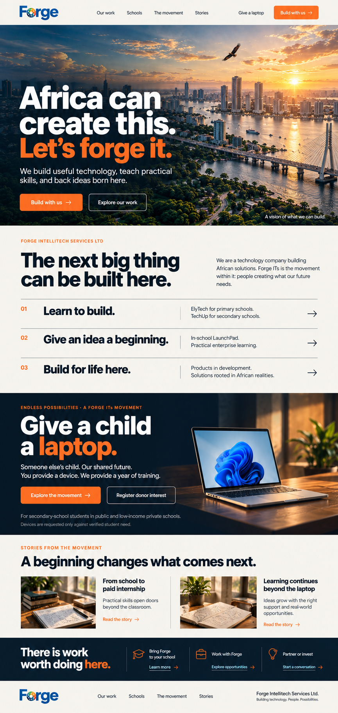
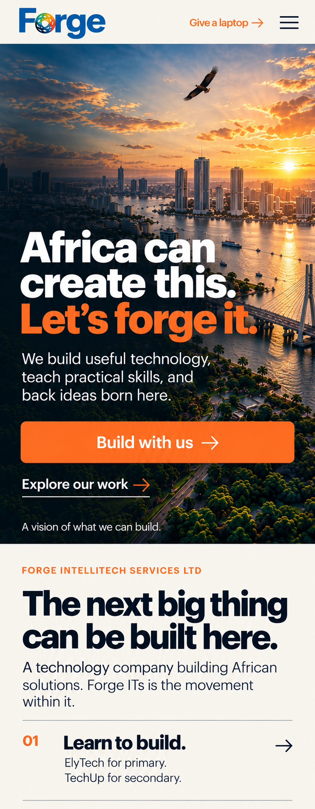
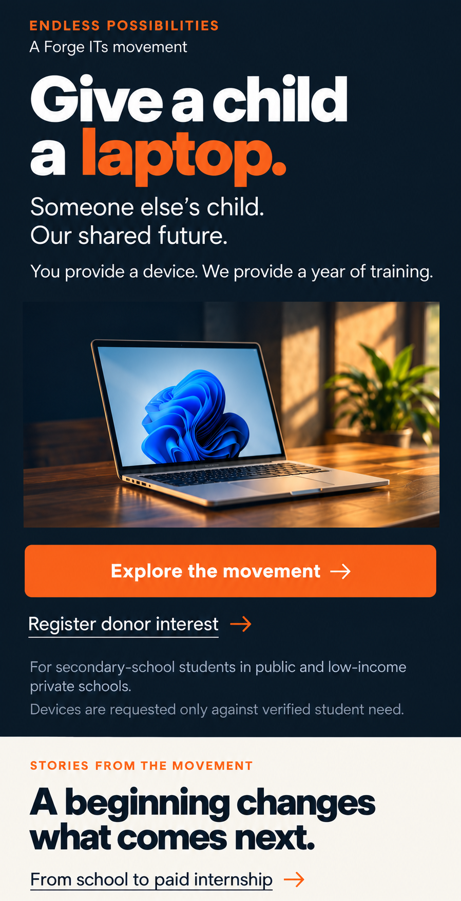
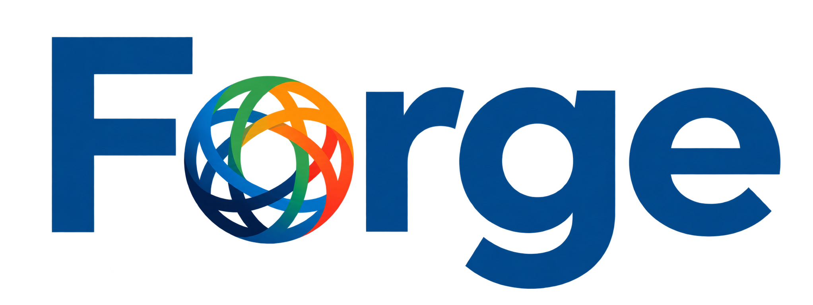

# Refined Forge homepage — desktop and mobile

20 October 2026 · Visual review, before implementation

The founder approved developing the recommended combination: the first concept's cinematic opening with the second concept's bold typography, company clarity and editorial rows. These mockups are that refinement, not three more alternative directions.

**Branch:** `codex/forge-website-redesign`. No production deployment, promotion, main-branch merge or live-domain change is authorised. The completed website still needs explicit final approval before launch.

## Desktop

The light masthead gives the new blue logo a clear home. The cinematic imagined Nigerian landscape opens with “Africa can create this. Let's forge it.” The following off-white section explains the company and separates its programmes through ruled rows. A substantial laptop campaign section leads into stories and routes for schools, prospective colleagues and partners/investors.

## Mobile opening

This is a phone-width opening view with the beginning of the following section, not a miniature full desktop page. The primary action is full width, navigation collapses to a menu, and the laptop campaign remains directly accessible in the header.

## Mobile campaign detail

This separate scrolled detail shows the campaign's mobile treatment: copy, device image, primary button, donor-interest link and eligibility notes stacked in one column. It is a continuation of the same homepage. An earlier compressed mobile study was superseded and is not saved as the implementation target.

## New logo

The source is [the new logo found in Drive](https://drive.google.com/file/d/1ISxIoBWiImmBSQXpIyd5vcekgFUnuCBH/view), which uses blue lettering and a multicoloured interlocking symbol as its “o”. It replaces the older globe-style ForgeITS mark for this direction.

The founder authorised removing the lower “IntelliTech / Service Ltd” wording from the logo. The transparent Forge-only asset is prepared at `public/images/brand/forge-wordmark.png`, with the original JPEG preserved as `forge-logo-source.jpg`. The isolated asset was created with an image-editing tool from that source; it is a cleaned raster derivative, not a newly supplied official vector master. The full “g” descender is retained. No subtitle or ITS suffix belongs inside the compact wordmark.

Use the company legal name in relevant body/footer text, independently from the logo. Company: **Forge Intellitech Services Ltd**. Movement within it: **Forge ITs**. That distinction remains unchanged by simplifying the header logo.

The mockups use this new identity. The existing runtime `Logo.tsx` has not yet been changed: connecting the asset to the website belongs to the implementation step after this visual review.

## Selected structure and copy

1. Light masthead: compact Forge-only mark, Our work, Schools, The movement, Stories, Give a laptop and Build with us. Mobile: mark, campaign link and menu control.
2. Cinematic hero: “Africa can create this. Let's forge it.” Body: “We build useful technology, teach practical skills, and back ideas born here.” Primary Build with us; secondary Explore our work. Label scenery “A vision of what we can build.”
3. Company: “The next big thing can be built here.” Explain the technology company and its movement before the programme rows.
4. Work rows: Learn to build — ElyTech for primary, TechUp for secondary; Give an idea a beginning — In-school LaunchPad; Build for life here — products in development.
5. Endless Possibilities: “Give a child a laptop.” “Someone else's child. Our shared future.” “You provide a device. We provide a year of training.” Actions Explore the movement and Register donor interest. Explain secondary-school eligibility and verified-demand matching.
6. Story section: From school to paid internship; Learning continues beyond the laptop. These are founder-provided story directions, not approved final case-study copy or documentary images.
7. Invitation and footer: Bring Forge to your school; Work with Forge; Partner or invest. Keep the company legal identity in footer text.

## Responsive implementation notes

These are visual specifications to implement and test, not measurements verified from a running site. Image-generation output dimensions are not CSS viewport dimensions.

- Desktop content uses a centred maximum width around 1280px with fluid gutters. The landscape can extend to both viewport edges. At 1440px, the header and desktop row layout should have room to breathe.
- Collapse the navigation before its labels become crowded; begin checking around 960px and choose the actual breakpoint from content fit. The menu must be keyboard operable and close correctly.
- Mobile begins from a 390px design viewport with 24px gutters, adjusted to 20px if needed at 320px. Avoid horizontal overflow, text clipping and fixed-height sections that cut off copy.
- Use at least 16px normal body text, comfortable line-height and 44px minimum interactive targets. Scale headlines with the viewport and content; preserve intentional line breaks where they fit without hard-coding widths that break zoom.
- Stack company copy and programme descriptions on narrow screens. Each work row keeps its heading and description together. Do not shrink desktop columns.
- In the mobile campaign, the device photograph occupies a separate row after the message. Primary action and donor-interest link are separate rows. Eligibility copy stays readable. Do not reproduce the two-column campaign from the rejected compressed mobile study.
- Keep the blue wordmark on a light surface. Preserve intrinsic aspect ratio, transparent padding and the full descender; set its rendered height/width deliberately rather than using the source canvas as visual size. Use appropriate alt text and an accessible home link.
- Preserve the orange accent, but verify actual text contrast. Use dark navy labels on bright-orange controls or a darker orange with white labels when necessary to meet contrast requirements; the mockup's colours are not an accessibility test result.
- Plan video as a later enhancement. The founder generates it from a detailed storyboard. Provide a still-image version, reduced-motion behaviour, pause control where appropriate and a lightweight mobile alternative. No audio autoplay.
- Avoid child imagery in all cases. Future landscapes and object still-lifes are illustrative and must never be presented as proof of a real recipient, project or office.
- The campaign appears across public pages, with a navigation route and contextually useful placements. Evaluate conversions after implementation; do not claim this placement is already the highest converting.

## Review and next step

The question at this stage is whether the refined identity, narrative and desktop/mobile hierarchy are right. Once selected, use these files as the visual target for a working homepage on the same branch, then review that page before extending the design across the rest of the site. A visual approval is not a production approval.

The underlying [redesign plan](../README.md) and [source review](../source-review.md) still govern eligibility, factual verification, private data handling, integrations and the final launch gate. Source impact counters and speculative product promises are not introduced into these mockups.
